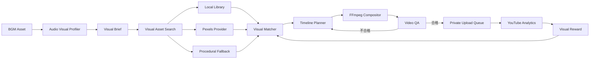

# BGM連動映像パイプライン 再設計

## 1. 結論

Shortsは単一背景にBGMを載せる動画ではなく、BGMのTheme・テンポ・エネルギー・音色に合う複数の映像クリップを自動選定し、音楽区間と同期して編集する。

初期の標準映像源は次の2つとする。

1. 利用者が所有・撮影・許諾確認したローカル映像
2. Pexels APIから取得し、出典とライセンス情報を保存した映像

Gradient、Particles、Waveformだけの映像は通常コンテンツには使わず、映像素材不足やレンダリング障害時のフォールバックに限定する。

AI動画生成はオプションProviderとして設計に含めるが、RTX 3060 Ti 8GBでは生成速度とVRAM余裕が不足するため初期標準にはしない。

## 2. 完成動画のイメージ

### Shorts

- 1080×1920、9:16、30fps、35〜45秒
- 5曲を7〜8秒ずつ使用
- 各曲に別の映像クリップを割り当てる
- 曲の切替と同時に映像も切り替える
- Rank、曲名、短いMoodラベルを安全領域内に表示
- Waveformは主役にせず、下部の補助表現に限定
- 150〜250msのクロスフェード、ライトフラッシュ、ブラー遷移をThemeに応じて使用
- 冒頭0.5秒以内に最も強い映像と音のHookを提示

例: `summer_drive`

1. 海沿い道路を走る車載映像
2. 水面と陽光の反射
3. ヤシの木と青空
4. 夕暮れの道路
5. 街の灯りへ入るドライブ映像

例: `night_drive`

1. 雨のフロントガラス
2. ネオン街の走行映像
3. トンネル内の光
4. 夜景と高速道路
5. 都市のタイムラプス

### 長尺Mix

- 1920×1080、16:9、30fps
- 同じThemeの景観クリップを20〜60秒単位でゆっくり切り替える
- 急なカットを避け、2〜4秒のディゾルブを使用
- 同一クリップの短時間再利用を禁止
- Now Playing、曲名、控えめなWaveformを表示
- 1時間動画では映像を再エンコードし続けず、前処理済みクリップをFFmpegで連結する

## 3. 新しい処理フロー



### 3.1 Audio Visual Profiler

BGM解析結果から映像向け特徴量を作る。

- Theme
- BPM
- RMS／Energy
- Spectral centroidによる明るさ
- Onset密度
- Hook区間
- 推定Mood
- 色温度
- 推奨カメラ速度
- 推奨カット速度

例:

```json
{
  "theme": "summer_drive",
  "mood": ["bright", "refreshing", "open_air"],
  "subjects": ["coastal road", "ocean", "sunset drive"],
  "avoid": ["faces", "logos", "dark indoor"],
  "palette": ["cyan", "gold", "sky_blue"],
  "motion": "medium_forward",
  "bpm": 124
}
```

### 3.2 Visual Asset Ingest

映像は取得直後に投稿へ使わず、Visual Asset Poolへ登録する。

保存情報:

- ProviderとProvider Asset ID
- 元ページURL
- 撮影者名とプロフィールURL
- ライセンス名と取得日時
- 原本SHA-256
- 解像度、FPS、尺、向き
- Theme、Mood、Subject、Color、Motionタグ
- 人物、顔、ロゴ、透かしの有無
- 利用承認状態
- 最終利用日時と利用回数

Pexels素材を使用した動画のDescriptionには、使用素材の撮影者とPexelsページへのクレジットを自動挿入する。

### 3.3 Visual Matcher

各BGM区間と映像候補の適合度を次で評価する。

```text
VisualMatchScore =
    0.30 * ThemeSimilarity
  + 0.20 * MoodSimilarity
  + 0.15 * MotionTempoMatch
  + 0.15 * ColorMatch
  + 0.10 * OrientationQuality
  + 0.10 * VisualQuality
  - ReusePenalty
  - SafetyPenalty
```

初期はタグ一致で実装し、素材数が増えた後にCLIP埋め込みによる画像内容の類似検索を追加する。

必須制約:

- `approved = true`
- ライセンス情報が欠けていない
- Shortsでは縦動画を優先
- 直近10本で同じ素材を使わない
- 1本のShort内でProvider Asset IDを重複させない
- 顔、企業ロゴ、車のナンバー、透かしが検出された素材は自動利用しない

### 3.4 Timeline Planner

1曲ごとに次のSceneを作る。

```text
Scene
├─ bgm_asset_id
├─ visual_asset_id
├─ audio_start / audio_end
├─ visual_in / visual_out
├─ crop rectangle
├─ speed factor
├─ color preset
├─ transition
├─ rank / title / mood label
└─ attribution
```

映像速度は原則0.85〜1.15倍に限定し、音楽へ無理に合わせた不自然な高速化を避ける。カットはBGMのHook開始、曲切替、強いOnsetの近傍へスナップする。

### 3.5 FFmpeg Compositor

CPUの`libx264`を標準とし、ACE-StepとのGPU競合を避ける。

処理:

1. 9:16または16:9へクロップ
2. fpsと色空間を統一
3. 軽いカラーグレーディング
4. 曲切替に同期したトランジション
5. Rank、曲名、Moodを描画
6. 補助Waveformを合成
7. loudnorm済みBGMを配置
8. H.264/AACへ出力

字幕と主要被写体はShorts UIに隠れない中央安全領域へ配置する。

### 3.6 Video QA

アップロード前に次を自動検査する。

- 1080×1920または1920×1080
- 30fps
- H.264/AAC、48kHz
- 目標尺
- 黒画面率
- 静止フレーム継続率
- 音声欠落、無音率、クリッピング
- 映像と曲切替時刻の差
- テキストの画面外はみ出し
- 同一映像の重複率
- 出典・ライセンス欠落
- content hash重複

QA不合格動画は投稿キューへ入れない。

## 4. データモデル

既存の`youtube_videos`に加えて次を導入する。

### visual_assets

```text
id, provider, provider_asset_id, source_url,
author_name, author_url, license_name, license_snapshot,
original_file, sha256, width, height, fps, duration_sec,
orientation, theme_tags, mood_tags, subject_tags,
palette_tags, motion_score, quality_score,
has_people, has_logo, has_watermark,
approval_state, last_used_at, use_count, created_at
```

### video_projects

```text
id, kind, theme, state, output_file, content_hash,
visual_brief_json, qa_json, synthetic_media,
youtube_video_record_id, created_at, completed_at
```

### video_scenes

```text
video_project_id, scene_index, bgm_asset_id, visual_asset_id,
audio_start, audio_end, visual_in, visual_out,
crop_json, speed_factor, transition, overlay_json
```

### visual_usage

```text
visual_asset_id, video_project_id, used_at
```

## 5. Job状態

```text
waiting_assets
planning
rendering
quality_check
review_required
ready_for_upload
uploading
uploaded
failed
```

`ready_for_upload`になった動画だけを既存のYouTubeアップロードキューへ渡す。

## 6. Scheduler

```text
03:15  BGM候補生成
04:00  一時ファイル整理
06:00  Visual Asset候補取得
07:00  Visual QA・Pool登録
08:00  Shorts構成作成
08:05  Shortsレンダリング・Video QA
08:15  Privateアップロード
05:00  前日までのAnalytics収集
```

映像取得、BGM生成、動画レンダリングは別Queueにし、1つの失敗で他の処理を停止させない。

## 7. Theme Profile拡張

各Themeへ映像ルールを追加する。

```yaml
summer_drive:
  visual_queries:
    - coastal road driving
    - ocean sunlight
    - palm trees summer
    - sunset highway
  mood_tags: [bright, refreshing, open_air]
  palette: [cyan, sky_blue, gold]
  motion: medium
  avoid: [face, logo, indoor, accident]
  transitions: [crossfade, light_flash]
```

## 8. Analyticsによる改善

BGMだけでなく映像の影響を分離して記録する。

- Visual Asset別のEngaged views
- Theme×Visual Subject別の平均視聴率
- 冒頭映像別の3秒到達相当指標
- Transition別の離脱傾向
- BGMと映像の組合せ別実績

同じBGMを異なる映像で試す場合も、短期間に類似動画を大量投稿せず、少数のPrivate確認後に間隔を空けて比較する。

## 9. AI生成映像の扱い

初期標準では無効とする。

- Wan2.1 T2V-1.3Bの公称VRAMは8.19GBで、8GB GPUでは余裕がない
- 5秒480pの生成自体が高負荷で、日常利用やACE-Stepと競合する
- 有効化する場合は夜間の専用Queue、CPU offload、低解像度生成、後段アップスケールを使う
- AI生成音楽・現実的なAI生成映像を使う場合はYouTubeの`containsSyntheticMedia`を明示する
- 実在人物、実在事件、実在場所を誤認させる生成Promptは禁止する

## 10. 実装順序

1. `visual_assets`、`video_projects`、`video_scenes`をSQLiteへ追加
2. ローカル映像Providerと素材登録CLIを実装
3. Pexels Provider、出典保存、Descriptionクレジット生成を実装
4. Theme Visual ProfileとVisual Matcherを実装
5. Shorts Timeline PlannerとFFmpeg Compositorを実装
6. Video QAを実装
7. `ready_for_upload`から既存Privateアップローダーへ接続
8. ダッシュボードへ映像Provider・Visual Subject別分析を追加
9. 実動画3本をPrivate投稿し、スマートフォンで表示確認
10. 確認後に`auto_upload`を有効化

## 11. 完了条件

- 5つのBGMそれぞれに意味的に合う別映像を割り当てられる
- 曲切替と映像切替が同期する
- 同一映像の過剰再利用を防止できる
- 全映像の出典、利用条件、取得日時を追跡できる
- 映像QA合格動画だけがPrivate投稿される
- AnalyticsからBGMと映像の両方を比較できる

## 12. 参照

- Pexels API: https://www.pexels.com/api/documentation/
- Pexels License: https://www.pexels.com/legal-pages/license/
- Wan2.1公式リポジトリ: https://github.com/Wan-Video/Wan2.1
- YouTube altered／synthetic content: https://support.google.com/youtube/answer/14328491
- YouTube Video resource `containsSyntheticMedia`: https://developers.google.com/youtube/v3/docs/videos
